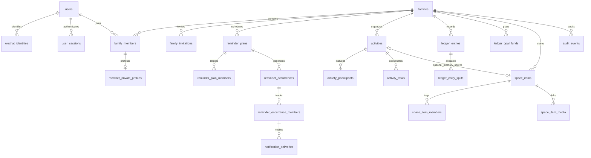

# Nestful relational data model v2

Status: implemented and deployed on 2026-10-16. Production health confirms
`relational-v2`. The early-data reset retains the legacy JSONB row and a private
backup; new runtime records start in the separate `nestful` schema. Phone preview
and two-account acceptance remain pending. See [cutover evidence](v2-cutover-2026-10-16.md).

## Product decisions

- Every active family member has a WeChat login. A user can join several families.
- Permissions are admin/member; elder/child/guest are independent identity tags.
- Ordinary family content is shared; emergency contact and private notes are
  visible only to the member and family admins.
- Recurring reminders follow the calendar regardless of prior completion.
  Participants complete their own occurrence independently.
- Activities and digital space are independent modules. Saving an activity as a
  memory is explicit, idempotent, and creates a snapshot with an optional source link.
- Early test data may be reset. Take a backup first; no dual-write rollout.
- No password vault, file upload, payment, or arbitrary item sharing in this release.

## Persistence

Migrations: services/api/migrations/003_relational_v2_up.sql through 005. Tables live in the
private nestful schema, with no client Data API grants. Runtime DML is granted
to nestful_runtime; migrations run with separate owner privileges. The runtime
cannot create tables or modify/delete audit events. API family authorization is
mandatory and is not delegated to Supabase Auth JWTs or presented as RLS protection.

All independent entities have UUID IDs. Time is timestamptz; recurring calendar
calculations use the family's IANA time zone, default Asia/Shanghai. Money is
integer cents within JavaScript's safe-integer range. Composite foreign keys
prevent cross-family references. Versioned edits return 409 on conflicts.

| Module | Tables |
| --- | --- |
| Identity | users, wechat_identities, user_sessions |
| Family | families, family_members, member_private_profiles, family_invitations |
| Reminders | reminder_plans, reminder_plan_members, reminder_occurrences, reminder_occurrence_members, notification_deliveries |
| Activities | activities, activity_participants, activity_tasks |
| Ledger | ledger_entries, ledger_entry_splits, ledger_goal_funds |
| Digital space | space_items, space_item_members, space_item_media |
| Audit | audit_events |

wechat_identities contains only id, user_id, app_id, openid, nullable unionid,
created_at. AppID identifies the app and is identical for that app's users.
OpenID identifies a user within the app; (app_id,openid) is unique. Do not use
OpenID as the public user ID or store a WeChat session_key. Session tokens and
invite codes are hashed, not stored in plaintext.

The complete field types, constraints, foreign keys, and indexes are authoritative
in the migration SQL. JSONB is limited to versioned schedule configuration,
immutable occurrence snapshots, and sanitized audit details.

## Atomic operations and lifecycle

- Create family plus first admin in one transaction. A deferred constraint and
  family-row locking protect the last active admin. Inactivate members, preserve
  history, and reactivate the same (family,user) record on rejoin.
- Invite acceptance locks the invitation, validates availability, and binds the
  authenticated user; an accepted code cannot join a different user.
- Reminder generation locks plans using SKIP LOCKED; occurrence, participants,
  delivery tasks, and schedule cursor commit together. Unique keys prevent
  duplicate generation. Members joining later affect future snapshots only.
- Subscription acceptance authorizes the next eligible notification only. Other
  and future notifications require that recipient to authorize again.
- Delivery workers claim atomically with lease tokens. External sending happens
  outside transactions. Known failures retry at most three attempts. A timed-out
  or interrupted send becomes unknown and is not blindly retried. Provider
  acceptance is not proof of reading or device delivery.
- Expired notifications are not bulk sent after downtime. Occurrences may still
  be generated for history; completion does not advance the schedule.
- Each expense's splits sum exactly to its amount, checked at transaction commit.
  Income has no splits. Equal splitting sorts member IDs before allocating the
  remainder. Monthly summaries use the family time zone. Goal funds are manual
  progress records, not real money accounts.
- Activities do not reference digital-space entries. An explicit save operation
  creates a memory snapshot. A partial unique index allows one source memory per
  activity, including after archival; edits to the source do not edit the snapshot.
- Audit events are append-only and exclude tokens, raw invitation codes, and
  private profile content.

## API and rollout contract

Keep WeChat login and the existing resource routes with {data} responses. Every
private request verifies the token, active family membership, and action rules.
Use /v1/me/families instead of a global family directory. Derive actor IDs from
the server session, never from client-submitted creator/owner IDs. Validate chosen
payers, participants, and assignees as active members of that family.

Use cursors for lists (50 default, 100 maximum). Include version on editable
records; require it for updates. Provide separate reminder participation and
notification DTOs. Keep actual JS and TS clients synchronized.

First test with disposable local Postgres, then configure production with a
login permitted to enter nestful_runtime. A dedicated login is preferred; for the
initial cutover the user chose the existing postgres pooler connection and
explicitly authorized its SET-role membership. Back up legacy JSONB, initialize an empty
v2 schema, deploy matching API/client, and disable legacy writes. Do not switch
back to stale JSONB after v2 writes. On failure pause writes and repair/restore
the new database. Generate a preview; final release requires user acceptance.

## Verification

Use real Postgres for constraints, transactional rollback, concurrent logins,
invite contention, family isolation, private fields, version conflicts, last-admin
protection, reminder generation/claim races, subscription reuse, per-member
completion, expense totals, independent modules, and idempotent memory snapshots.
Two real WeChat accounts must verify the final preview separately; automated
local tests do not substitute for WeChat authorization or phone acceptance.
